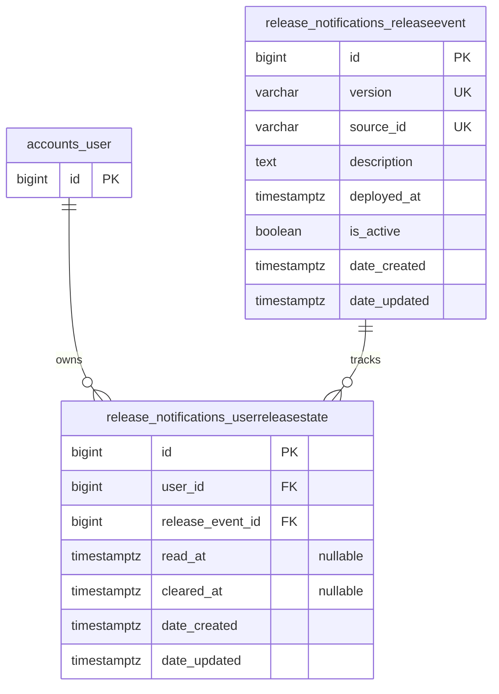

# Release Notification Database Structure

Feature: #164. Review draft reflecting the current Django models and migrations.
Database: PostgreSQL. Django app: `release_notifications`.

## Model Relationships

`accounts_user` is the existing user table; no user columns are added. A release
can have state records for multiple users, and a user can have state records for
multiple releases. Absence of a state record means the release is unread.

## ReleaseEvent

Table: `release_notifications_releaseevent`

| Column | PostgreSQL type | Nullable | Django default | Meaning |
| --- | --- | --- | --- | --- |
| `id` | `bigint` identity | No | Generated | Primary key; stable release event identity. |
| `version` | `varchar(255)` | No | None | Unique user-facing release version, e.g. `12.9.3`. |
| `source_id` | `varchar(255)` | No | None | Unique Azure build/release identifier, e.g. `BUILD-1234`. |
| `description` | `text` | No | Empty string | Optional plain-text summary of what the release introduced; supports multiple lines. |
| `deployed_at` | `timestamp with time zone` | No | None | Successful deployment completion time. |
| `is_active` | `boolean` | No | `true` | Whether the event is eligible for selection. |
| `date_created` | `timestamp with time zone` | No | Set on creation | Record creation timestamp. |
| `date_updated` | `timestamp with time zone` | No | Set on model save | Record modification timestamp. |

Example description: `Improved survey validation and added external choice-file checks.`

Constraints and indexes:

- Primary key on `id`.
- Separate unique constraints on `version` and `source_id`.
- B-tree index `release_event_current_idx` on `(is_active, deployed_at DESC)`.
- Default application ordering is `deployed_at DESC, id DESC` for deterministic ties.
- No description length limit or full-text index is configured.

## UserReleaseState

Table: `release_notifications_userreleasestate`

| Column | PostgreSQL type | Nullable | Django default | Meaning |
| --- | --- | --- | --- | --- |
| `id` | `bigint` identity | No | Generated | Primary key. |
| `user_id` | `bigint` | No | None | Foreign key to `accounts_user.id`. |
| `release_event_id` | `bigint` | No | None | Foreign key to `release_notifications_releaseevent.id`. |
| `read_at` | `timestamp with time zone` | Yes | `NULL` | When this user read this release notification. |
| `cleared_at` | `timestamp with time zone` | Yes | `NULL` | When this user cleared this release notification. |
| `date_created` | `timestamp with time zone` | No | Set on creation | State record creation timestamp. |
| `date_updated` | `timestamp with time zone` | No | Set on model save | State record modification timestamp. |

Constraints and indexes:

- Primary key on `id`.
- Unique constraint `unique_user_release_state` on `(user_id, release_event_id)`.
- Django creates indexes on both foreign-key columns.
- State belongs to one user and one exact release; it cannot suppress another release.
- Clearing does not require a read timestamp; no timestamp-order check is configured.

## Derived State

The status is calculated from timestamps; there is no stored `state` column.

| Condition | Result |
| --- | --- |
| No state row, or both action timestamps are null | `unread` |
| `read_at` is set and `cleared_at` is null | `read` |
| `cleared_at` is set, regardless of `read_at` | `cleared` |

## Storage and Integrity Notes

- Description is shared release content; it is not copied into each user's row.
- Description allows blank content but never SQL `NULL`. Existing releases receive
  an empty string through migration `0002_releaseevent_description`.
- Re-recording the same version/source pair returns the existing release without
  overwriting its description, deployment time, or active flag. This behavior is
  enforced by the recording service, not by a database immutability constraint.
- Identifier validation is performed by the recording service. Database `NOT NULL`
  constraints alone do not reject empty strings.
- Version/source comparisons use the database's normal string semantics; this
  app does not add the case-insensitive collation used by some other project models.
- Foreign keys use Django `on_delete=CASCADE`: ORM deletion of a user or release
  removes its state rows. Django's PostgreSQL foreign keys do not configure SQL
  `ON DELETE CASCADE`; direct SQL deletion must respect referential integrity.
- Boolean, text, and timestamp defaults shown above are application defaults.
  No persistent SQL defaults or timestamp triggers are specified by these models.
- Use timezone-aware timestamps. No viewer timezone is stored in these tables.
- Each database is assumed to represent one deployment environment; there is no
  `environment` column. A shared database across environments would require a
  reviewed change to release identity and uniqueness constraints.
- No retention or automatic deletion policy is configured. Historical rows remain
  available in the full notification history. The panel shows the latest five-event
  window, excluding cleared entries; the history page shows 20 records per page,
  including previously cleared records. Reading never removes a record.
