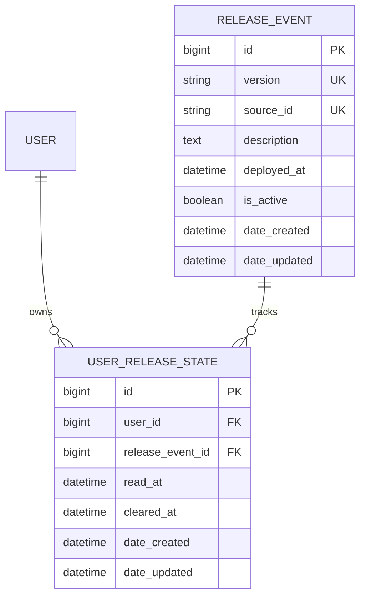

# Release Notification Architecture Plan

Status: Working implementation. Parent feature: #164.

## Agreed Behavior

The panel shows up to five recent releases, with New and Read badges. Clicking a
release marks only that entry read and keeps it visible. Opening the bell does
not mark entries read. View all notifications opens `/notifications`, a simple
release history with 20 entries per page and full descriptions.

Clear notifications dismisses the visible entries from the panel but never
deletes release events or their history. The panel uses the latest five-event
window; clearing it does not refill it with older releases. The history includes
previously cleared releases. Cleared entries are treated as already seen in the
UI. Inactive and future-dated events are excluded.

This supersedes the original latest-only requirement and opening-to-read behavior.

## Deployment and User Flow

```mermaid
sequenceDiagram
    participant DevOps as Azure DevOps
    participant API as Django backend
    participant DB as PostgreSQL
    participant UI as Frontend
    participant User
    DevOps->>API: Run record_release after successful deployment
    API->>DB: Store unique release event and description
    UI->>API: GET recent releases after login/focus/poll/bell open
    API->>DB: Load recent events and this user's states
    API-->>UI: Recent entries and total unread count
    UI-->>User: Bell marker and New/Read entries
    User->>UI: Click a release
    UI->>API: POST event ID/read
    API->>DB: Persist read_at for this user/event
    API-->>UI: Updated entry
    UI-->>User: Show Read badge; retain entry
    User->>UI: View all notifications
    UI->>API: GET release history?page=1
    API-->>UI: 20 entries plus pagination
    User->>UI: Clear visible notifications
    UI->>API: POST clear with displayed event IDs
    API->>DB: Persist cleared_at; retain history
```

## Data Structure



There is one state row per user/release, enforced by a unique constraint. No state
row means unread. State is derived from timestamps; cleared takes precedence.
The standalone database specification is `RELEASE_NOTIFICATION_DATA_MODEL.md`.
History needs no new model or schema migration.

## API Endpoints

All user endpoints require authentication. Session mutations require CSRF.
GET requests do not mark anything read.

| Method | Path under /api/release-notifications/ | Purpose |
| --- | --- | --- |
| GET | `recent/` | Latest five-event window, excluding cleared entries, plus total unread count. |
| GET | `?page=1` | All eligible releases, 20 per page, including read and cleared entries. |
| POST | `{id}/read/` | Mark one clicked release read; keep it visible. |
| POST | `clear/` | Clear supplied event IDs from the panel; maximum five IDs. |
| GET | `current/` | Original current-release endpoint retained for compatibility. |
| POST | `{id}/clear/` | Original single-event clear endpoint retained for compatibility. |

Recent response:

```json
{
  "results": [
    {
      "id": 2,
      "version": "12.9.4",
      "description": "Improved survey validation.",
      "deployed_at": "2026-10-13T09:30:00Z",
      "state": "unread"
    }
  ],
  "unread_count": 1
}
```

History additionally returns `count`, `next`, and `previous`. The unread count is
per user across all eligible releases, including older entries only visible in
history. Reading one release does not automatically clear other unread entries.

Clear request:

```json
{ "release_ids": [2, 1] }
```

Clear response:

```json
{ "cleared_ids": [1, 2] }
```

Clear uses exact IDs so a release arriving during the request remains unaffected.
Invalid or unavailable IDs fail without partially applying the batch.

## Polling and Reconciliation

- Fetch after authentication, bell opening, visible-tab focus, and every five
  visible minutes.
- Pause timed polling while hidden.
- Failed fetches retry after 15 seconds, then 30, 60, 120, 240, and up to five minutes.
- Prevent overlapping fetches within each list controller.
- Apply read/clear state only after API success; preserve state on failure and offer Retry.
- Ignore stale fetches that predate mutations, and fetch authoritative state again.
- Abort requests on logout, account change, page change, and unmount.
- Reading in history signals the header to refresh its unread marker.
- A release discovered while open stays New until explicitly clicked.
- Display deployment timestamps in the viewer's locale and timezone.

## Release Creation

The deployment producer is a management command, not an HTTP creation endpoint:

```bash
python manage.py record_release --release-version 12.9.4 --source-id BUILD-1235 --description "Improved survey validation."
```

Deployment time defaults to now or can be supplied with `--deployed-at`.
Matching version/source retries return the existing record without rewriting
content. Conflicting identifiers fail. Azure DevOps still needs to invoke this
command after successful deployment. A protected internal producer endpoint can
be added if the deployment environment cannot execute the command.

## Verification

Backend tests cover history pagination, visibility eligibility, ownership, read
retention, clear persistence, idempotency, invalid batches, and CSRF. Frontend
tests cover both badges, item reading, error retries, polling, stale responses,
account cleanup, history, and next-page navigation. Browser scenarios cover
keyboard interaction, mobile bounds, View all navigation, and real session API
integration.

Run backend tests from `dj-be` and frontend tests from `react-ui`:

```bash
pytest -q -o addopts= survey_designer/apps/release_notifications/tests
pnpm exec vitest run src/app/components/ReleaseNotifications/ReleaseNotifications.test.tsx
pnpm exec playwright test e2e/tests/release-notifications.spec.ts --project=chromium
```

The optional live browser scenario accepts `E2E_RELEASE_LIVE_SESSIONID`, a
disposable local Django session, plus `E2E_API_URL` and `E2E_BASE_URL`. It needs
an unread test release. Do not use a production session.

## Manual Checks

1. Record a release and sign in. Confirm the bell has an unread marker.
2. Open the bell. Confirm New and Read entries appear without automatically reading them.
3. Click a New entry. Confirm its badge becomes Read and it remains in the panel.
4. Follow View all notifications. Confirm full descriptions and older releases appear.
5. Clear the panel. Confirm those releases remain in history after reload.
6. Record a newer release while the panel is open. Focus the tab; it remains New until clicked.
7. Block read/clear requests. Confirm Retry appears and entries do not falsely change state.
8. Check hidden-tab pause, logout cleanup, keyboard actions, mobile bounds, and pagination.
